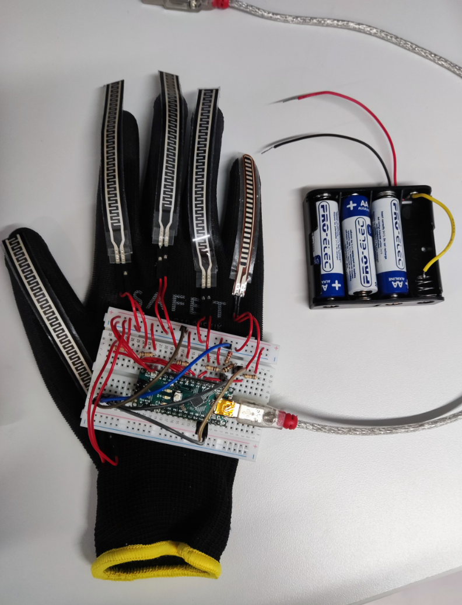

[← Back to Home page](../index.md)

# Remotely-Controllable Bionic Hand

 

### Project Description
Project desc.

 

### Bionic Hand Demo
Here's a video of the working bionic hand.  

<video controls width="70%">
  <source src="../Bionic-Hand\final_demo.mp4">
  Sadly your browser does not support embedded videos.
</video>
[Open video in a new tab](../Bionic-Hand\final_demo.mp4)

 

### Bionic Hand Demo
Here's a video of the working bionic hand.  

<video controls width="70%">
  <source src="../Bionic-Hand\final_demo.mp4">
  Sadly your browser does not support embedded videos.
</video>
[Open video in a new tab](../Bionic-Hand\final_demo.mp4)

 

### Prototype Demo Videos
Here are some videos of the prototypes I built. The last image shows a glove that should have been able to remotely control the bionic hand. Sadly, I couldn't get the bluetooth module working in time. Hopefully I'll come back to this project soon to get it working. Make sure to stay tuned for that! 

<table>
  <tr>
    <td align="center" width="50%">
      <video controls width="100%">
        <source src="../Bionic-Hand/prototype1_demo.mp4" type="video/mp4">
        Sadly, your browser does not support embedded videos.
      </video>
      
<em>Simple flex sensor and Arduino circuit demo</em>

    </td>
    <td align="center" width="50%">
      <video controls width="100%">
        <source src="../Bionic-Hand/prototype2_demo.mp4" type="video/mp4">
        Sadly, your browser does not support embedded videos.
      </video>
      
<em>Single finger prototype demo</em>

    </td>
  </tr>
  <tr>
    <td align="center" width="50%">
      <video controls width="100%">
        <source src="../Bionic-Hand\prototype3_motorwall_demo.mp4" type="video/mp4">
        Sadly, your browser does not support embedded videos.
      </video>
      
<em>Motor wall prototype demo</em>

    </td>
    <td align="center" width="50%">
      
      
<em>Glove controller prototype</em>

    </td>
  </tr>
</table>

 