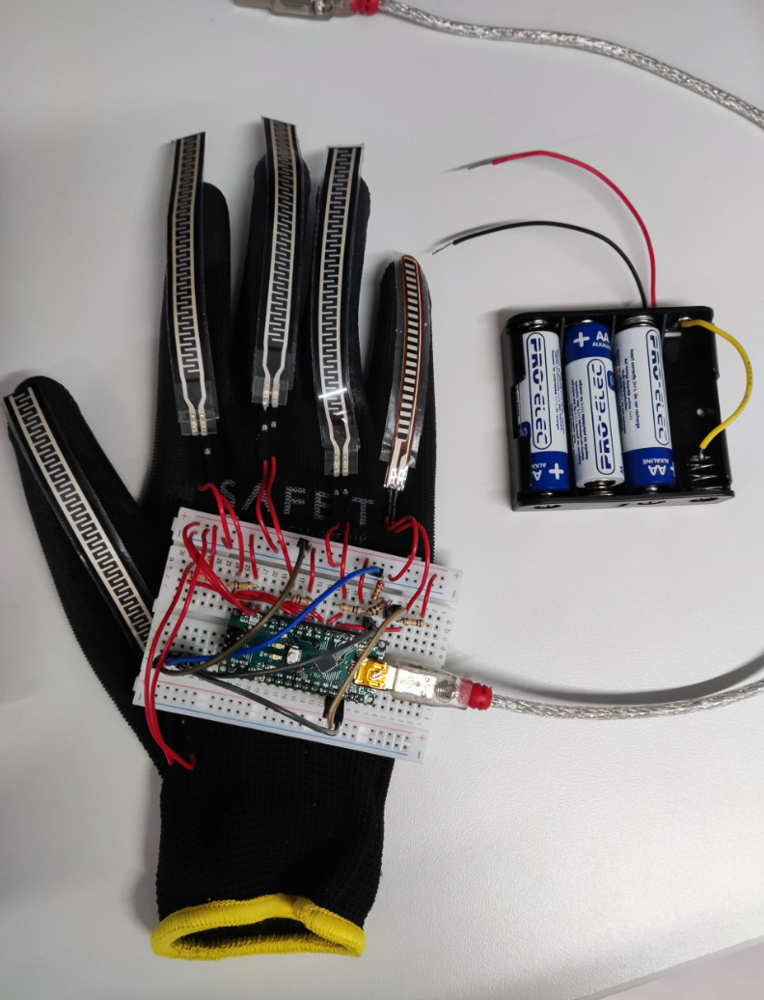

[← Back to Home page](../index.md)

# Remotely-Controllable Bionic Hand

 

### Project Description
As someone who has always been interested in prosthetics, I wanted to create a bionic hand. My plan was to have allow it to be controlled wirelessly using a glove worn by the user. 

The hand contains fingers that can be pulled downwards using nylon string connected to separate motors. Once released by the motors, the finger springs back into position due to the tension in thick elastic string inside them. I wanted the Arduino circuit controlling the hand to be able to communicate with the Arduino Nano circuit controlling the glove through Bluetooth modules. Flex sensors on each of the glove's fingers would be able to detect if the user's fingers are bent and tell the motors in the bionic hand to turn accordingly.

I learnt a lot about CAD and 3D-printing during this project. I also got a lot of experience in the workshop working with various drilling and sawing tools to fix issues with my prints. I also learnt how to code in Arduino C and practiced my circuit-building skills. 

One of my favourite parts of this project was having to be super resourceful in fixing issues with my prints. At one point, the holes that ran through the 3D-printed palm were too small for the string to fit through. I tried using various drills, but it was impossible to drill in the exact direction of the hole. So I ended up trying to erode the hole using a clothes hanger and stringing the elastic through with a needle (inspired by my crocheting).

 

### Bionic Hand Demo
Here's a video of the working bionic hand.  

<video controls width="50%">
  <source src="../Bionic-Hand\final_demo.mp4">
  Sadly your browser does not support embedded videos.
</video>
[Open video in a new tab](../Bionic-Hand\final_demo.mp4)

 

### Prototype Demo Videos
Here are some videos of the prototypes I built. The last image shows a glove that should have been able to remotely control the bionic hand. Sadly, I couldn't get the bluetooth module working in time. Hopefully I'll come back to this project soon to get it working. Make sure to stay tuned for that! 

<table>
  <tr>
    <td align="center" width="50%">
      <video controls width="100%">
        <source src="../Bionic-Hand/prototype1_demo.mp4" type="video/mp4">
        Sadly, your browser does not support embedded videos.
      </video>
      
<em>Simple flex sensor and Arduino circuit demo</em>

    </td>
    <td align="center" width="50%">
      <video controls width="100%">
        <source src="../Bionic-Hand/prototype2_demo.mp4" type="video/mp4">
        Sadly, your browser does not support embedded videos.
      </video>
      
<em>Single finger prototype demo</em>

    </td>
  </tr>
  <tr>
    <td align="center" width="50%">
      <video controls width="100%">
        <source src="../Bionic-Hand\prototype3_motorwall_demo.mp4" type="video/mp4">
        Sadly, your browser does not support embedded videos.
      </video>
      
<em>Motor wall prototype demo</em>

    </td>
    <td align="center" width="50%">
      
      
<em>Glove controller prototype</em>

    </td>
  </tr>
</table>

 

### Initial Designs
Here are some photos from my designing process. 

<em>Design sketches 1.0</em>

 

<em>Design sketches 2.0</em>

 

<em>Design sketches 3.0</em>

 

### Fusion 360 (CAD)
Here are some photos from my Fusion 360 design process. 

<table>
  <tr>
    <td align="center" width="50%">
      
      
<em>Finger joints</em>

    </td>
    <td align="center" width="50%">
      
      
<em>Palm</em>

    </td>
  </tr>
  <tr>
    <td align="center" width="50%">
      
      
<em>Palm holes</em>

    </td>
    <td align="center" width="50%">
      
      
<em>Motor wall</em>

    </td>
  </tr>
</table>

 

### Workshop images
And finally, here are some bonus images of me in the workshop!

<table>
  <tr>
    <td align="center" width="50%">
      
      
<em>Drilling finger joints</em>

    </td>
    <td align="center" width="50%">
      
      
<em>Pillar drill</em>

    </td>
  </tr>
</table>

 