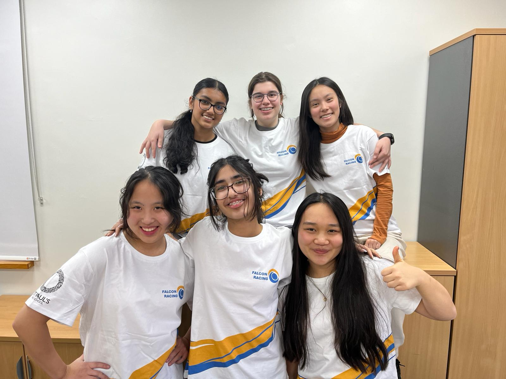
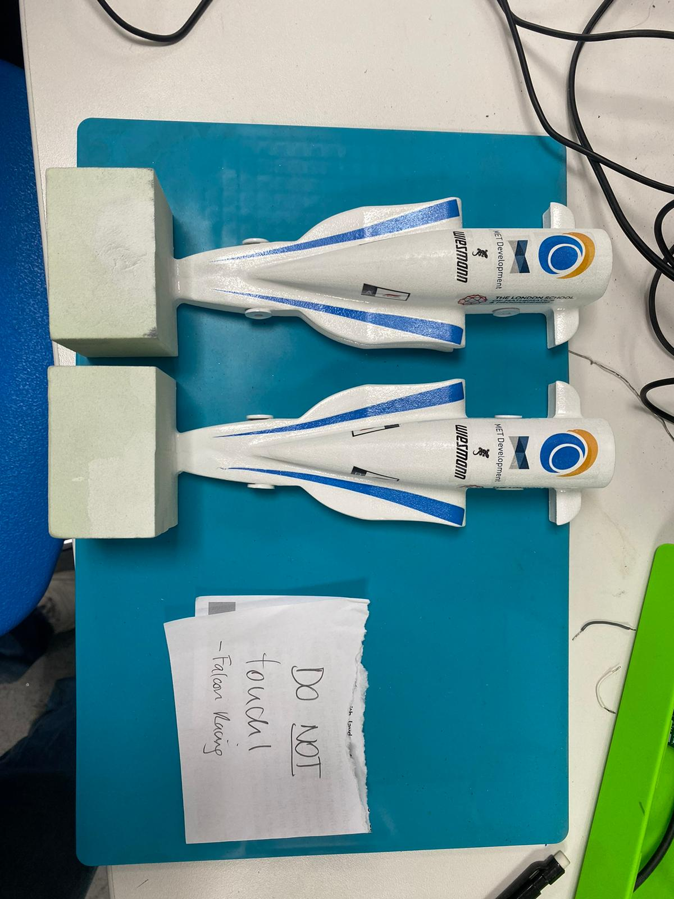
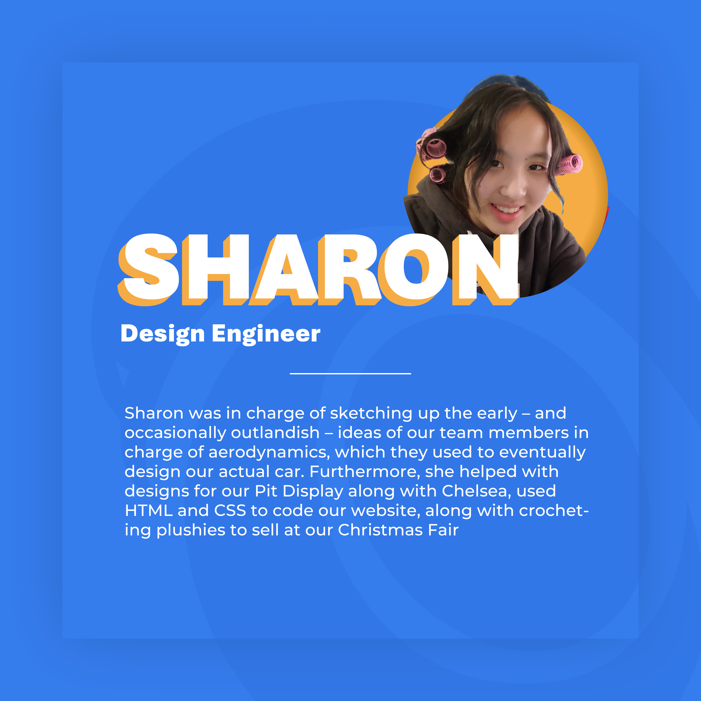

[← Back to Home page](../index.md)

# Falcon Racing - F1 in Schools (STEM Racing)

 

### Project Description
I was the Lead Design Engineer for Team Falcon Racing. We participated in F1 in Schools (now known as STEM Racing) and won first place in Regionals, qualifying us for Nationals. I was responsible for many early sketches of our car and coordinated with members in charge of aerodynamics. Besides that, I coded our team website and helped us raise money by crocheting plushies to sell at our school's Christmas Fair. 

 

### Team Photos

<em>Falcon Racing Team Photo (I am on the far left of the bottom row)</em>

 

<table>
  <tr>
    <td align="center" width="50%">
      
      
<em>Our F1 cars</em>

    </td>
    <td align="center" width="50%">
      
      
<em>My "Meet the Team" Intro</em>

    </td>
  </tr>
</table>

 

### Website
You can access the source code for the website in the repo below.
[Falcon Racing Website](https://github.com/Shr00mp/Falcon-Racing-Website)
