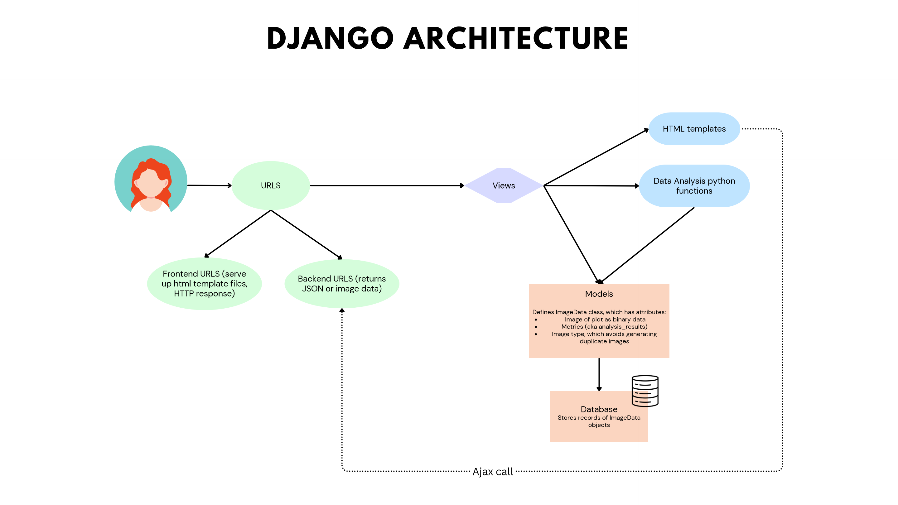
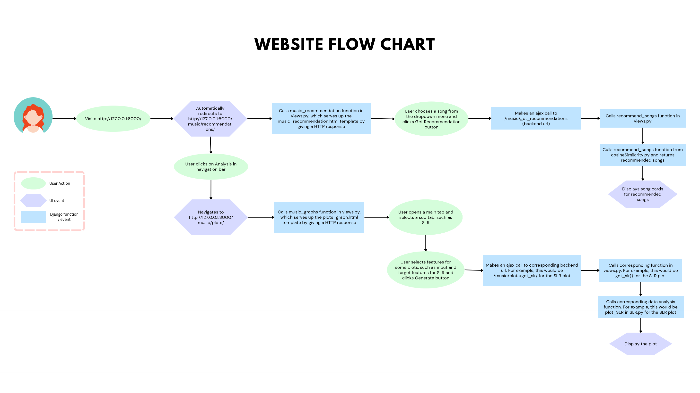

[← Back to Home page](../index.md)

# Rusic Exploration and Recommendation Website

 

### Project Description
Project desc.

 

### Music Recommendation Demo
The user can search for a song and get a ranked recommendation of 6 tracks. I used the cosine similarity algorithm for this.
A demonstration of this feature is shown below. Actually, this recommendation in particular introduced me to Björk, who is now one of my favourite artists!

<em>Music recommendation demo</em>

 

### Music Exploration Demos
Besides getting recommendations, the user has the option to do some music exploration. An example of some of these tools are shown below

<table>
  <tr>
    <td align="center" width="50%">
      
      
<em>Heatmap tool</em>

    </td>
    <td align="center" width="50%">
      
      
<em>Binary classification tool</em>

    </td>
  </tr>
  <tr>
    <td align="center" width="50%">
      
      
<em>SLR (Single Linear Regression) tool</em>

    </td>
    <td align="center" width="50%">
      
      
<em>MLR (Multiple Linear Regression) tool</em>

    </td>
  </tr>
</table>

 

### Flow Charts
I also created a couple of system flow charts, which you can find below. 

<em>Django architecture flow chart</em>

 

<em>Website flow chart</em>

 
